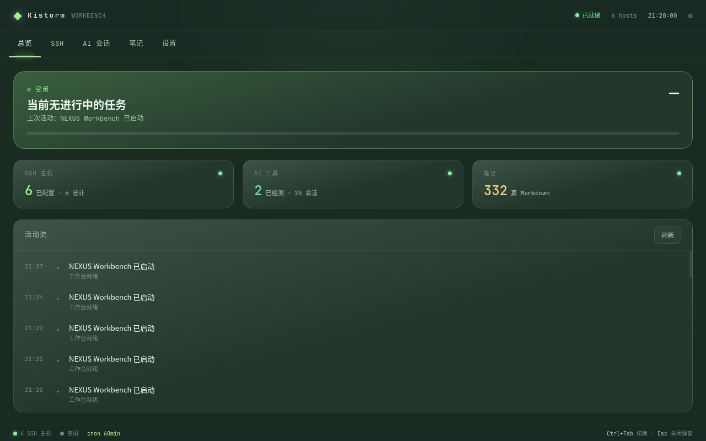
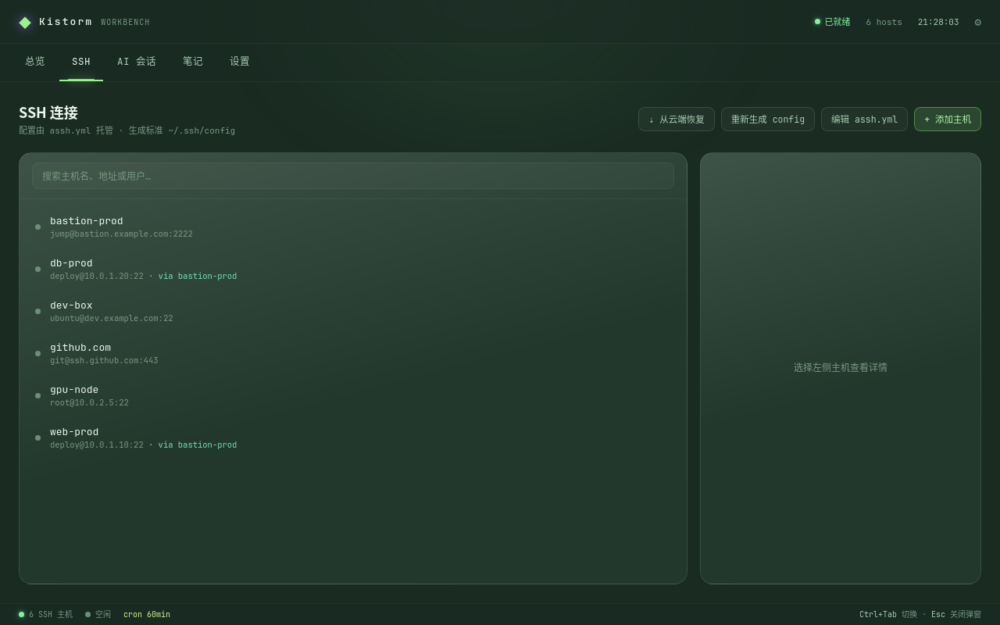
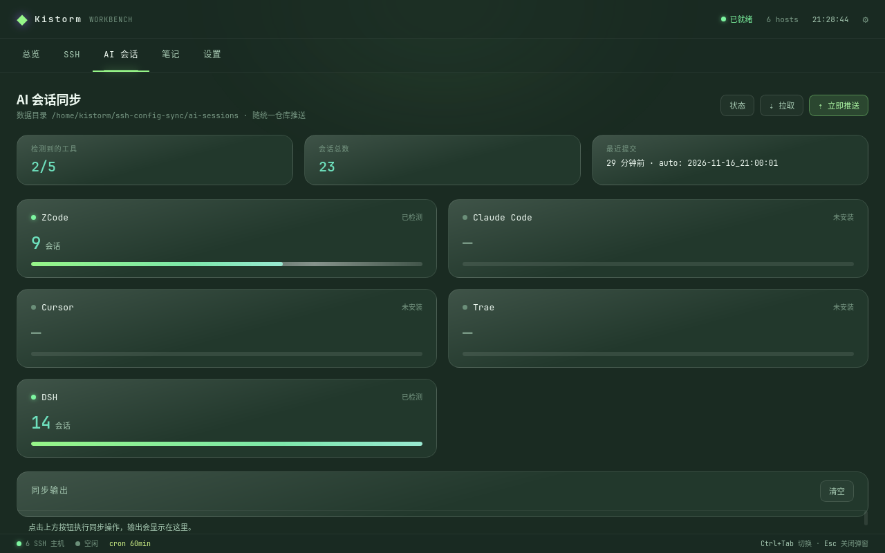
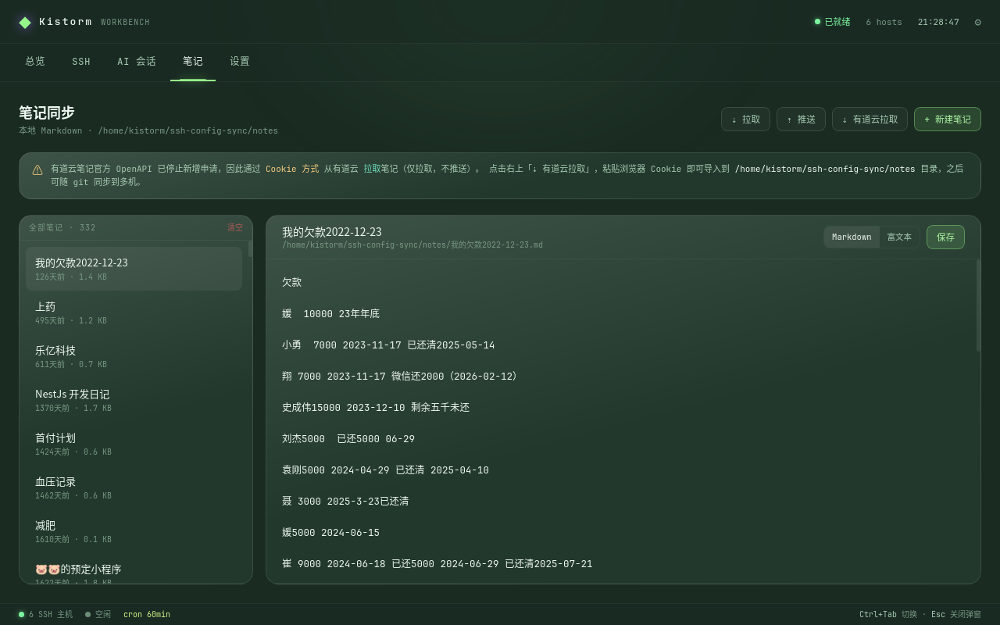
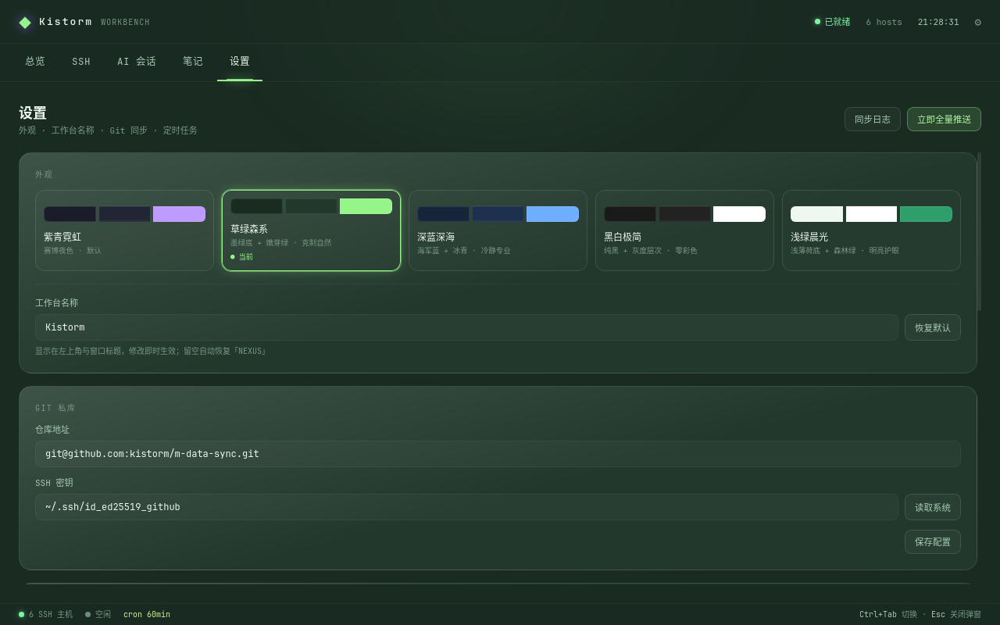

# NEXUS Workbench · ai-m-sync-tool

> A unified desktop workbench for **SSH management**, **AI coding-session sync**, and **note sync** — all backed by a single private Git repository.

[中文文档](README.zh-CN.md) · [Screenshots](#screenshots) · [User Manual](#user-manual)



---

## Why

Developers juggle too many scattered tools: SSH configs, AI IDE chat histories, notes, and cloud backups. NEXUS Workbench brings them into one desktop app with a single sync backbone:

- One private Git repo stores **SSH config + notes + AI session data**
- One-click push/pull, plus scheduled background sync
- Works offline-first; Git is the only dependency for sync

## Features

| Module | What it does |
|---|---|
| **SSH Management** | Manage hosts in `assh.yml` (aliases, jump hosts, templates, wildcards); auto-generates standard `~/.ssh/config`; test connectivity; edit host info; per-host password vault (local only) |
| **Built-in Terminal** | Multi-tab xterm.js terminal backed by a real PTY; auto-login with saved passwords; sessions survive page switching |
| **Electerm Integration** | Open any host in Electerm with credentials passed via CLI; auto-detects the binary; download hints if missing |
| **AI Session Sync** | Syncs ZCode, Claude Code, Cursor, Trae, and DeepSeek Harness (dsh) session data into the unified repo |
| **Notes Sync** | Local Markdown notes with rich-text/Markdown dual-mode editor; delete-and-push |
| **Youdao Note Pull** | Pulls notes from Youdao Note (Cookie-based, pull-only) and converts them to Markdown |
| **Unified Sync** | Push/pull everything in one action; global force-restore; SSH-only force-pull |
| **Scheduled Sync** | Built-in cron installer (every N minutes) + in-app timer fallback |
| **Theming** | 5 built-in themes: Neon, Forest, Ocean, Mono, Light-Green; custom app name |

## Screenshots

### SSH Management
Host list with jump-host markers, regex hosts, and per-host actions.



### AI Session Sync
Auto-detects installed AI tools and syncs their session data.



### Notes
Local Markdown notes with a Markdown / rich-text dual editor.



### Settings & Themes
5 color themes, custom workbench name, Git repo config, cron settings.



---

## Architecture

```
┌─────────────────────────────────────────────────────────┐
│  Tauri desktop app (Rust + React + TypeScript)          │
│                                                         │
│  Frontend (React 19 + Tailwind v4 + xterm.js)           │
│    Dashboard · SSH · AI Sync · Notes · Settings         │
│                                                         │
│  Rust backend (34 commands)                             │
│    │                                                    │
│    ├── assh  ────►  ~/.ssh/assh.yml  ──►  ~/.ssh/config │
│    ├── PTY (portable-pty) ──► system ssh ──► terminal   │
│    ├── ai-session-sync.sh ──► ai-sessions/              │
│    ├── notes ──► notes/*.md                             │
│    └── git ──► unified repo (push / pull / restore)     │
└─────────────────────────────────────────────────────────┘
                          │
                          ▼
         Private Git repo (e.g. GitHub `m-data-sync`)
         ├── assh.yml            SSH config
         ├── notes/              Markdown notes
         └── ai-sessions/        AI session data (dsh, zcode, …)
```

**Sync strategy**

| Action | Semantics |
|---|---|
| Push | Collect all sources → commit → pull(rebase, ours) → push |
| Pull | Merge from remote, local uncommitted changes win |
| Force restore (settings) | `reset --hard origin/main` — remote overwrites everything |
| SSH-only force pull | Restore only `assh.yml`, leave notes/AI untouched |

> Passwords are **never** synced. They live in a local `secrets.json` (mode 600) and are only used for terminal/Electerm auto-login.

---

## Getting Started

### Prerequisites

- Node.js ≥ 20 + pnpm
- Rust toolchain (stable)
- Linux: `libwebkit2gtk-4.1-dev libgtk-3-dev librsvg2-dev patchelf` (Ubuntu 24.04 also needs `libayatana-appindicator3-dev`)
- Optional: `assh` (SSH config compiler), `sshpass` (password auto-login), `xdotool` + `x11-utils` (bring Electerm to front on Linux)

### Install & run

```bash
git clone git@github.com:kistorm/ai-m-sync-tool.git
cd ai-m-sync-tool

pnpm install
pnpm tauri dev          # development
pnpm tauri build        # production bundle (.deb / AppImage / dmg / exe)
```

### First-run setup

1. Open **Settings → Git repo** and fill in your private repo URL + SSH key path
2. Set the **Electerm command** (auto-detect available)
3. Import or add SSH hosts in the **SSH** page
4. Configure paths: SSH dir (`~/.ssh`), notes dir, AI-sync script dir

---

## User Manual

### SSH Management

- **Add host**: `+ Add host` → alias / address / user / port / auth (key or password) / trust host
- **Edit**: select a host → `Edit connection` — alias, address, user, port, trust; unlisted fields (`inherit`, `identityfile`) are preserved
- **Password**: `View / change password` — password is stored locally only
- **Test**: `Test connectivity` — uses `sshpass` when a password exists
- **Regenerate config**: writes standard `~/.ssh/config` from `assh.yml` (also runs automatically after add/edit/delete)
- **Restore from cloud**: pull only `assh.yml` from the remote, then rebuild config
- **Templates & wildcards**: edit `assh.yml` directly for `inherit`, gateways, and regex hosts

### Built-in Terminal

- Select a host → `New terminal`; click `+ New` in the tab bar to open more (same host can open multiple tabs)
- Tabs keep their sessions alive when you switch pages; use `Minimize` to hide the workspace — the status bar shows `▸ Terminal N` to restore
- Password hosts auto-login; otherwise ssh prompts normally inside the terminal
- Full-screen apps (vim, htop) work — the PTY is resized with the panel

### AI Session Sync

- Auto-detects installed tools: **ZCode**, **Claude Code**, **Cursor**, **Trae**, **DeepSeek Harness (dsh)**
- `Push` collects sessions into `ai-sessions/` inside the unified repo and commits/pushes
- `Pull` fetches the repo, then restores data into each tool's directory
- SQLite databases are snapshotted via the online backup API (safe while apps run); SQLite restore is skipped when the app is running (use `--force` in the script to override)
- Cross-platform paths: Linux uses `~/.config`, macOS `~/Library/Application Support`, Windows `%APPDATA%`

### Notes

- Create/edit/delete Markdown notes; **Markdown** and **rich-text** modes (auto-converted back to Markdown on save)
- Delete triggers an automatic push so the deletion propagates to other machines
- **Pull from Youdao Note**: paste browser cookies, pull-only; same-name notes are overwritten by newer cloud versions
- **Clear all notes**: permanent local deletion (`.git` preserved)

### Sync & Scheduling

- **Settings → Sync repo**: push / pull / force restore / init repo
- **Scheduled sync**: set interval (minutes) and click `Install/Update` — writes a crontab entry running `auto-sync.sh` (SSH config + notes + AI sessions)
- **In-app timer** runs when crontab is not installed
- **Sync log**: view the tail of the background sync log

### Themes & Name

- 5 themes: Neon, Forest, Ocean, Mono, Light-Green
- Custom workbench name (shown top-left and in the window title)
- Preferences persist in `localStorage`

---

## Configuration Reference

`~/.local/share/<app-id>/config.json` (Linux; platform path varies):

| Key | Description |
|---|---|
| `git_repo` | Private Git repo URL (SSH) |
| `ssh_key` | SSH private key path for Git |
| `sync_interval_min` | Scheduled sync interval (minutes) |
| `conflict_strategy` | `newest_wins` |
| `notes_dir` | Notes directory (defaults inside the sync repo) |
| `ai_sync_dir` | Directory containing `ai-session-sync/sync.sh` |
| `ssh_dir` | SSH config directory (`~/.ssh`) |
| `electerm_cmd` | Electerm binary path |
| `auto_sync_enabled` | In-app timer switch |

## Development

```bash
# Backend tests (35 tests: unit + integration)
cd src-tauri && cargo test

# Frontend type check / build
pnpm exec tsc --noEmit
pnpm exec vite build
```

Project layout:

```
src/                 React frontend
  views/             Dashboard, SSH, AI, Notes, Settings
  components/        Terminal, UI kit
  store.tsx          App-level state (terminals, long tasks)
  api.ts             Tauri command bindings
src-tauri/src/       Rust backend
  core.rs            Config, activity log, secrets, command helpers
  ssh.rs             assh.yml CRUD, connectivity, Electerm, force pull
  terminal.rs        PTY-based terminal sessions
  ai.rs              AI tool detection + session sync
  notes.rs           Notes CRUD + git sync
  sync.rs            Unified repo push/pull/restore
  cron.rs            Cron installer + auto-sync script
  youdao.rs          Youdao Note pull
  tests.rs           35 unit/integration tests
docs/images/         Screenshots
```

## FAQ

**Q: Why doesn't my GitHub host open a terminal?**
GitHub's SSH endpoint (`git@ssh.github.com`) is a Git service — it does not allocate a PTY. The app detects Git-service hosts (GitHub/GitLab/Bitbucket/Gitee/Codeberg/sr.ht) and disables terminal entry points.

**Q: Do passwords sync across machines?**
No — by design. Only host definitions sync. On a new machine, re-enter passwords once.

**Q: "Pull" didn't restore a file I deleted locally.**
Regular pull is local-preferred. Use **Settings → Force restore** (`reset --hard`) or **SSH → Restore from cloud** for a remote-overwrites-local restore.

**Q: Electerm opened but the window is behind other windows.**
Electerm is single-instance; the app activates its window automatically (Linux requires `xdotool` + `xwininfo`).

**Q: Youdao Note integration?**
Official OpenAPI is closed to new applicants. This app uses Cookie-based pull (pull-only, no writes back).

## License

MIT
