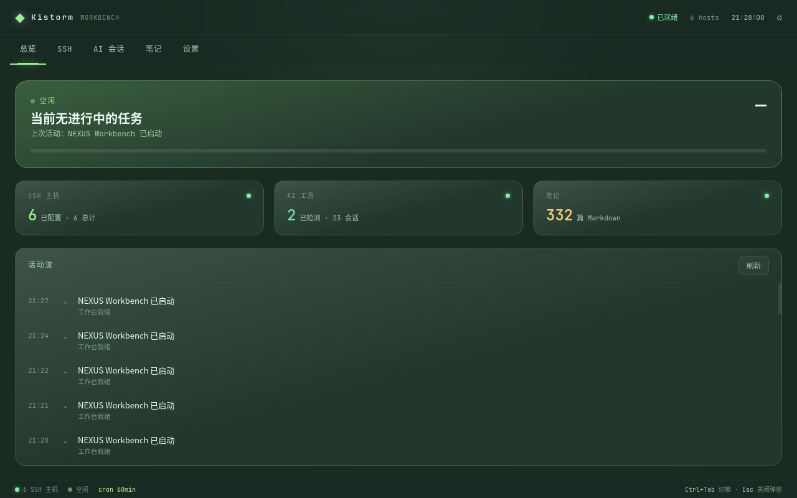

# NEXUS Workbench · ai-m-sync-tool

> 一体化的桌面工作台：**SSH 管理**、**AI 编码会话同步**、**笔记同步** —— 后端统一由一个私有 Git 仓库承载。

[English](README.md) · [界面截图](#界面截图) · [使用手册](#使用手册)



---

## 为什么做这个

开发者的工具太分散：SSH 配置、AI IDE 聊天记录、笔记、云端备份各管各的。NEXUS Workbench 把它们收进一个桌面应用，共用一套同步底座：

- 一个私有 Git 仓库同时存放 **SSH 配置 + 笔记 + AI 会话数据**
- 一键推送/拉取，外加定时后台同步
- 离线优先，同步只依赖 Git

## 功能特性

| 模块 | 说明 |
|---|---|
| **SSH 管理** | 在 `assh.yml` 中管理主机（别名、跳板、模板继承、正则通配）；自动生成标准 `~/.ssh/config`；测试连通性；编辑连接信息；每主机密码本地保管 |
| **内嵌终端** | 多标签 xterm.js 终端，背后是真实 PTY；保存过密码的主机自动登录；切换页面不断开 |
| **Electerm 集成** | 把凭据通过命令行传给 Electerm 直接连接；自动探测程序路径；未安装时给出各平台下载提示 |
| **AI 会话同步** | 同步 ZCode、Claude Code、Cursor、Trae、DeepSeek Harness（dsh）的会话数据到统一仓库 |
| **笔记同步** | 本地 Markdown 笔记，富文本/Markdown 双模式编辑；删除后自动推送 |
| **有道云拉取** | 基于 Cookie 拉取有道云笔记并转 Markdown（仅拉取） |
| **统一同步** | 一键推送/拉取全部；全局强制恢复；SSH 单独强制拉取 |
| **定时同步** | 内置 crontab 安装器（每 N 分钟）+ 应用内定时器兜底 |
| **主题系统** | 5 套主题：紫青霓虹 / 草绿森系 / 深蓝深海 / 黑白极简 / 浅绿晨光；工作台名称可改 |

## 界面截图

### SSH 管理
主机列表带跳板标记、正则主机，右侧为单主机操作面板。


### AI 会话同步
自动检测已安装的 AI 工具并同步其会话数据。


### 笔记
本地 Markdown 笔记，支持 Markdown / 富文本双模式编辑。


### 设置与主题
5 套配色、工作台名称、Git 仓库配置、定时任务。


---

## 架构

```
┌─────────────────────────────────────────────────────────┐
│  Tauri 桌面应用（Rust + React + TypeScript）             │
│                                                         │
│  前端（React 19 + Tailwind v4 + xterm.js）              │
│    总览 · SSH · AI 会话 · 笔记 · 设置                    │
│                                                         │
│  Rust 后端（34 个命令）                                  │
│    │                                                    │
│    ├── assh  ────►  ~/.ssh/assh.yml  ──►  ~/.ssh/config │
│    ├── PTY（portable-pty）──► 系统 ssh ──► 内嵌终端      │
│    ├── ai-session-sync.sh ──► ai-sessions/              │
│    ├── notes ──► notes/*.md                             │
│    └── git ──► 统一仓库（推送 / 拉取 / 恢复）            │
└─────────────────────────────────────────────────────────┘
                          │
                          ▼
         私有 Git 仓库（例如 GitHub `m-data-sync`）
         ├── assh.yml            SSH 配置
         ├── notes/              Markdown 笔记
         └── ai-sessions/        AI 会话数据（dsh、zcode 等）
```

**同步策略**

| 操作 | 语义 |
|---|---|
| 推送 | 收集全部数据 → 提交 → 拉取合并（rebase，本地优先）→ 推送 |
| 拉取 | 与远端合并，本地未提交修改优先 |
| 强制恢复（设置） | `reset --hard origin/main`，远端完全覆盖本地 |
| SSH 单独强制拉取 | 只恢复 `assh.yml`，不动笔记/AI 数据 |

> **全量内容加密是可选的**。在设置中配置「加密主密码」后，所有同步文件（`assh.yml`、`notes/`、`ai-sessions/`）会逐文件以 AES-256-GCM（10 万轮 SHA-256 派生）加密为 `encrypted/**/*.enc` 再推送；拉取时解密回原位置。SSH 密码仍只保存在本地 `secrets.json`（权限 600），**不参与同步**。

---

## 快速开始

### 环境要求

- Node.js ≥ 20 + pnpm
- Rust 工具链（stable）
- Linux 依赖：`libwebkit2gtk-4.1-dev libgtk-3-dev librsvg2-dev patchelf`（Ubuntu 24.04 还需 `libayatana-appindicator3-dev`）
- 可选：`assh`（SSH 配置编译器）、`sshpass`（密码自动登录）、`xdotool` + `x11-utils`（Linux 下把 Electerm 窗口置前）

### 安装与运行

```bash
git clone git@github.com:kistorm/ai-m-sync-tool.git
cd ai-m-sync-tool

pnpm install
pnpm tauri dev          # 开发模式
pnpm tauri build        # 打包（.deb / AppImage / dmg / exe）
```

### 首次配置

1. 打开 **设置 → Git 私库**，填入私有仓库地址与 SSH 密钥路径
2. 设置 **Electerm 命令**（可点"自动检测"）
3. 在 **SSH** 页导入或添加主机
4. 确认路径：SSH 目录（`~/.ssh`）、笔记目录、AI 同步脚本目录

---

## 使用手册

### SSH 管理

- **添加主机**：`+ 添加主机` → 别名 / 地址 / 用户 / 端口 / 认证方式（密钥或密码）/ 信任主机
- **编辑**：选中主机 → `编辑连接信息`，可改别名、地址、用户、端口、信任；表单未包含的字段（`inherit`、`identityfile`）会保留
- **密码**：`查看 / 修改密码`，密码仅存本地
- **测试**：`测试连通性`，有密码时走 `sshpass`
- **重新生成 config**：从 `assh.yml` 生成标准 `~/.ssh/config`（增删改主机后也会自动执行）
- **从云端恢复**：只拉取远端 `assh.yml`，随后重建 config
- **加密同步**（可选）：在设置中填写「加密主密码」。推送时 `assh.yml` / `notes/` / `ai-sessions/` 下每个文件都会单独加密为 `encrypted/**/*.enc`，明文被 gitignore 排除；拉取时解密回各自原位置。主密码不入库；SSH 密码（`secrets.json`）不参与同步。
- **模板与通配**：直接编辑 `assh.yml` 使用 `inherit`、gateways、正则主机

### 内嵌终端

- 选中主机 → `新建终端`；在标签栏点 `+ 新建` 可继续开（同一主机可多开，自动编号）
- 切换页面时标签会话保持；点 `最小化` 隐藏终端，状态栏出现 `▸ 终端 N` 可恢复
- 保存过密码的主机自动登录，否则在终端内正常提示输入
- vim / htop 等全屏程序可用，PTY 会随面板尺寸调整

### AI 会话同步

- 自动检测已安装工具：**ZCode**、**Claude Code**、**Cursor**、**Trae**、**DeepSeek Harness (dsh)**
- `推送`：把会话收集到统一仓库的 `ai-sessions/`，并提交推送
- `拉取`：先拉取仓库，再恢复到各工具目录
- SQLite 使用在线备份快照（应用运行中安全）；应用运行时跳过 SQLite 恢复（脚本加 `--force` 可强制）
- 跨平台路径：Linux 用 `~/.config`，macOS 用 `~/Library/Application Support`，Windows 用 `%APPDATA%`

### 笔记

- 新建/编辑/删除 Markdown 笔记；支持 **Markdown** 与 **富文本** 两种模式（保存时自动转回 Markdown）
- 删除后自动推送，让删除同步到其他机器
- **从有道云拉取**：粘贴浏览器 Cookie，仅拉取；同名笔记由云端较新版本覆盖
- **清空全部笔记**：本地永久删除（保留 `.git`）

### 同步与定时任务

- **设置 → 同步仓库**：推送 / 拉取 / 强制恢复 / 初始化仓库
- **定时同步**：设置间隔（分钟）后点 `安装/更新`，写入 crontab 执行 `auto-sync.sh`（SSH 配置 + 笔记 + AI 会话）
- 未安装 crontab 时由**应用内定时器**兜底
- **同步日志**：查看后台同步日志尾部

### 主题与名称

- 5 套主题：紫青霓虹、草绿森系、深蓝深海、黑白极简、浅绿晨光
- 工作台名称可改（显示在左上角与窗口标题）
- 偏好保存在 `localStorage`

---

## 配置参考

`~/.local/share/<app-id>/config.json`（Linux；其他平台路径不同）：

| 键 | 说明 |
|---|---|
| `git_repo` | 私有 Git 仓库地址（SSH） |
| `ssh_key` | 用于 Git 的 SSH 私钥路径 |
| `sync_interval_min` | 定时同步间隔（分钟） |
| `conflict_strategy` | `newest_wins` |
| `notes_dir` | 笔记目录（默认在同步仓库内） |
| `ai_sync_dir` | 含 `ai-session-sync/sync.sh` 的目录 |
| `ssh_dir` | SSH 配置目录（`~/.ssh`） |
| `electerm_cmd` | Electerm 程序路径 |
| `auto_sync_enabled` | 应用内定时器开关 |

## 开发

```bash
# 后端测试（35 个：单元 + 集成）
cd src-tauri && cargo test

# 前端类型检查 / 构建
pnpm exec tsc --noEmit
pnpm exec vite build
```

目录结构：

```
src/                 React 前端
  views/             总览 / SSH / AI / 笔记 / 设置
  components/        终端、UI 组件
  store.tsx          App 级状态（终端、长任务）
  api.ts             Tauri 命令封装
src-tauri/src/       Rust 后端
  core.rs            配置、活动日志、密码存储、命令封装
  ssh.rs             assh.yml 增删改查、连通性、Electerm、强制拉取
  terminal.rs        基于 PTY 的终端会话
  ai.rs              AI 工具检测 + 会话同步
  notes.rs           笔记增删改查 + git 同步
  sync.rs            统一仓库推送/拉取/恢复
  cron.rs            crontab 安装器 + 自动同步脚本
  youdao.rs          有道云笔记拉取
  tests.rs           35 个单元/集成测试
docs/images/         界面截图
```

## 常见问题

**Q：为什么 GitHub 主机不能开终端？**
GitHub 的 SSH 端点（`git@ssh.github.com`）是 Git 服务，不分配 PTY。应用会自动识别 Git 服务主机（GitHub/GitLab/Bitbucket/Gitee/Codeberg/sr.ht）并禁用终端入口。

**Q：SSH 密码会跨机器同步吗？**
不会。SSH 密码只保存在本地 `secrets.json`，从不参与同步。主密码加密的是主机定义、笔记与 AI 会话等数据，密码库被有意排除。

**Q：本地删除的文件，普通"拉取"为什么没恢复？**
普通拉取是本地优先。需要远端覆盖本地时，用 **设置 → 从云端强制恢复**（`reset --hard`）或 **SSH → 从云端恢复**。

**Q：Electerm 打开了但窗口跑到后面去了？**
Electerm 是单实例应用，应用会自动激活它的窗口（Linux 需要 `xdotool` + `xwininfo`）。

**Q：有道云笔记如何对接？**
官方 OpenAPI 已停止新增申请。本项目采用 Cookie 方式拉取（仅拉取，不写回）。

## 许可证

MIT
