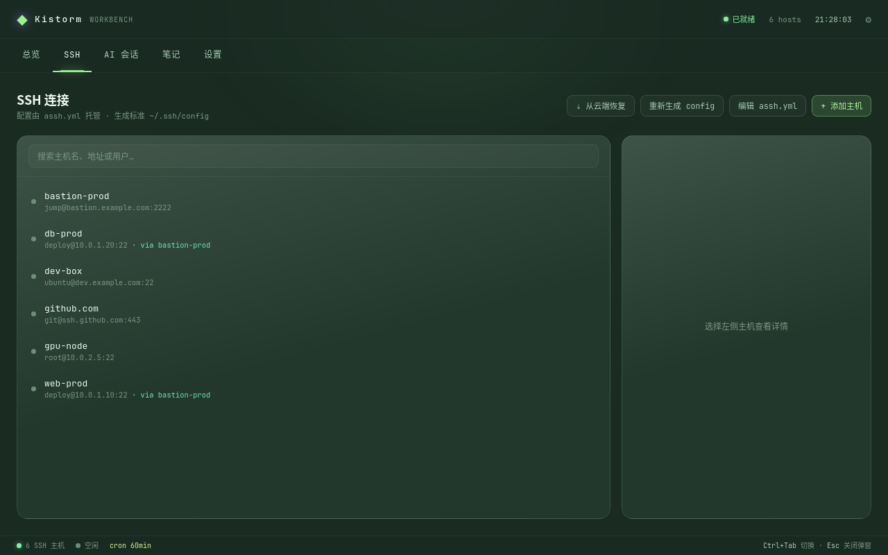
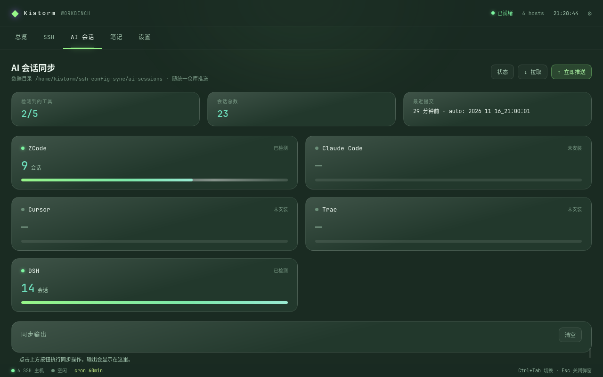
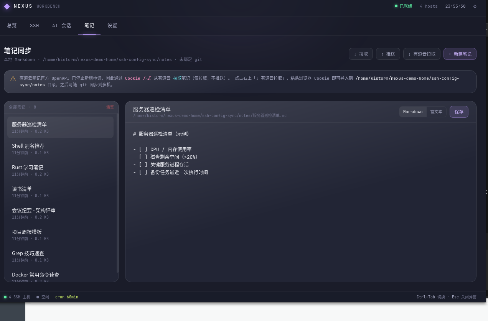
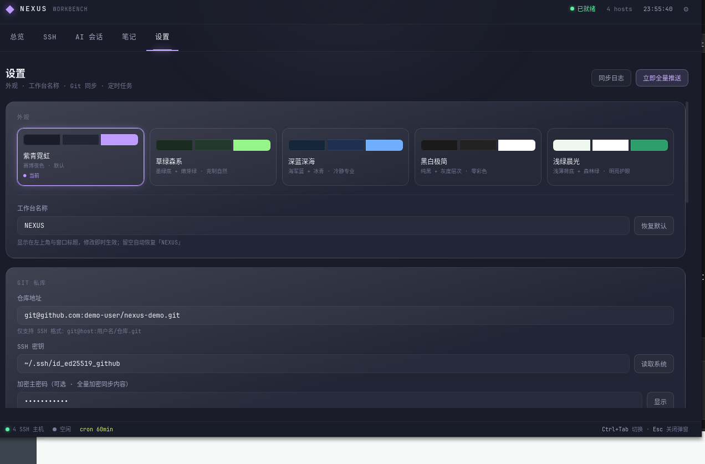
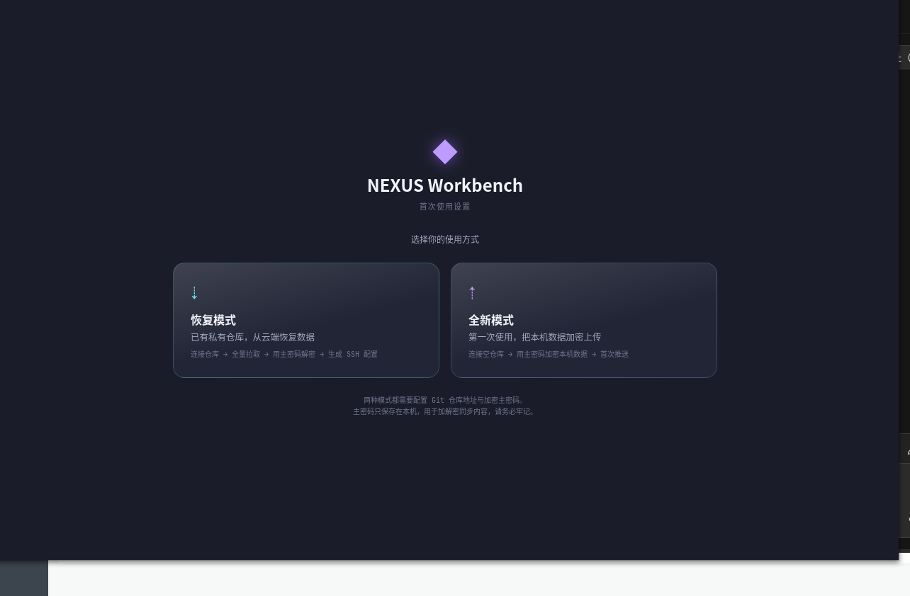
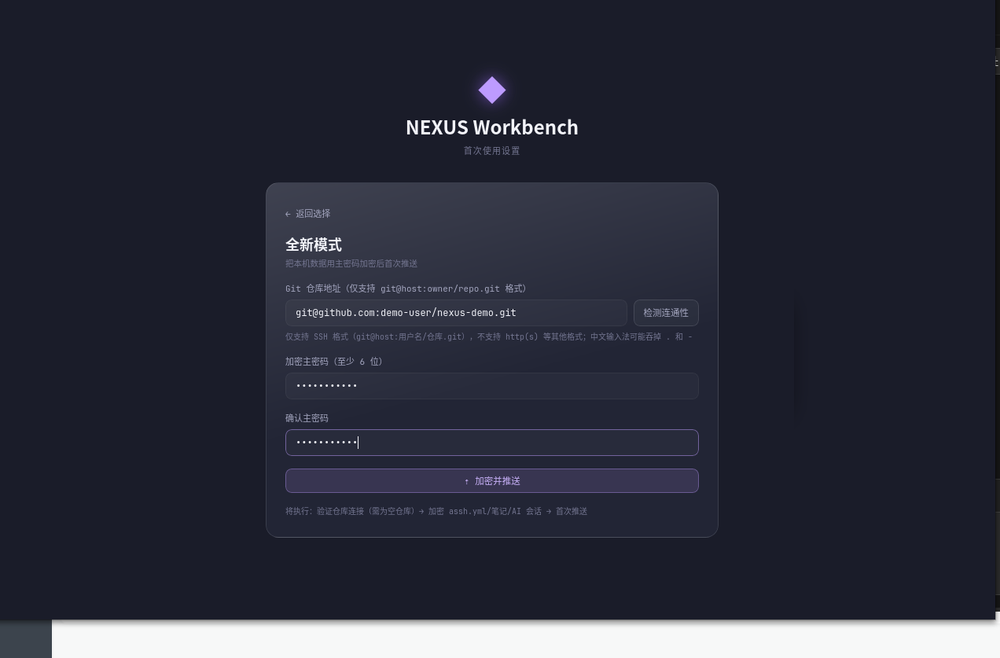

# NEXUS Workbench · ai-m-sync-tool

> 一体化的桌面工作台：**SSH 管理**、**AI 编码会话同步**、**笔记同步** —— 后端统一由一个私有 Git 仓库承载。

[English](README.md) · [界面截图](#界面截图) · [使用手册](#使用手册)


---

## 为什么做这个

开发者的工具太分散：SSH 配置、AI IDE 聊天记录、笔记、云端备份各管各的。NEXUS Workbench 把它们收进一个桌面应用，共用一套同步底座：

- 一个私有 Git 仓库同时存放 **SSH 配置 + 笔记 + AI 会话数据**
- 一键推送/拉取，外加定时后台同步
- 离线优先，同步只依赖 Git

## 功能特性

| 模块 | 说明 |
|---|---|
| **SSH 管理** | 在 `assh.yml` 中管理主机（别名、跳板、模板继承、正则通配）；自动生成标准 `~/.ssh/config`；测试连通性；编辑连接信息；每主机密码本地保管，设主密码后随仓库加密同步 |
| **SSH 单独推送/恢复** | 「⇡ 推送到仓库」只加密推送 assh.yml + 主机密码库；「⇣ 从云端恢复」取回密文解密还原，不动笔记/AI 数据 |
| **内嵌终端** | 多标签 xterm.js 终端，背后是真实 PTY；保存过密码的主机自动登录；切换页面不断开 |
| **Electerm 集成** | 把凭据通过命令行传给 Electerm 直接连接；自动探测程序路径（探测绝不启动程序）；未安装时给出各平台下载提示 |
| **AI 会话同步** | 同步 ZCode、Claude Code、Cursor、Trae、DeepSeek Harness（dsh）的会话数据到统一仓库 |
| **笔记同步** | 本地 Markdown 笔记，富文本/Markdown 双模式编辑；删除后自动推送 |
| **有道云拉取** | 基于 Cookie 拉取有道云笔记并转 Markdown（仅拉取） |
| **统一同步** | 一键推送/拉取全部；全局强制恢复；定时同步 |
| **首次引导** | 恢复模式/全新模式，全程进度条 + 5 秒倒计时进入主界面；Git 地址严格格式校验；连通性检测前置；网络抖动自动重试 |
| **定时同步** | 内置 crontab 安装器（每 N 分钟）+ 应用内定时器兜底 |
| **主题系统** | 5 套主题：紫青霓虹 / 草绿森系 / 深蓝深海 / 黑白极简 / 浅绿晨光；工作台名称可改 |

## 界面截图

### SSH 管理
主机列表带跳板标记、正则主机，右侧为单主机操作面板。



### AI 会话同步
自动检测已安装的 AI 工具并同步其会话数据。



### 笔记
本地 Markdown 笔记，支持 Markdown / 富文本双模式编辑。



### 设置与主题
5 套配色、工作台名称、Git 仓库配置、定时任务。



---

## 架构

```
┌─────────────────────────────────────────────────────────┐
│  Tauri 桌面应用（Rust + React + TypeScript）             │
│                                                         │
│  前端（React 19 + Tailwind v4 + xterm.js）              │
│    总览 · SSH · AI 会话 · 笔记 · 设置                    │
│                                                         │
│  Rust 后端（50+ 个命令）                                 │
│    │                                                    │
│    ├── assh  ────►  ~/.ssh/assh.yml  ──►  ~/.ssh/config │
│    ├── PTY（portable-pty）──► 系统 ssh ──► 内嵌终端      │
│    ├── ai-session-sync.sh ──► ai-sessions/              │
│    ├── notes ──► notes/*.md                             │
│    ├── secrets ──► secrets.json（主机密码库，600）       │
│    ├── crypto ──► AES-256-GCM 逐文件加解密               │
│    └── git ──► 统一仓库（推送 / 拉取 / 恢复 / 引导）      │
└─────────────────────────────────────────────────────────┘
                          │
                          ▼
         私有 Git 仓库（例如 GitHub `m-data-sync`）
         ├── assh.yml            SSH 配置（明文模式）
         ├── encrypted/          加密模式下的全部密文
         │   ├── assh.yml.enc
         │   ├── secrets.json.enc   主机密码库
         │   ├── notes/*.enc
         │   └── ai-sessions/**.enc
         └── .enc_salt           密钥派生盐
```

**同步策略**

| 操作 | 语义 |
|---|---|
| 推送（设置） | 加密全部内容 → 提交 → 拉取合并（rebase，本地优先）→ 推送 |
| **SSH 单独推送** | 只加密 assh.yml + 密码库并提交推送，不动笔记/AI |
| 拉取（设置） | 与远端合并，本地未提交修改优先 |
| 强制恢复（设置） | `reset --hard origin/main`，远端完全覆盖本地 |
| **SSH 单独恢复** | 取回 `encrypted/assh.yml.enc` → 主密码解密 → 重建 `~/.ssh/config` |
| 首次引导·恢复模式 | 连接仓库 → 全量拉取 → 主密码解密 → 重建 SSH 配置 |
| 首次引导·全新模式 | 连接空仓库 → 主密码加密本机数据 → 首次推送（云端已验证为空，强制覆盖） |

> **全量内容加密是可选的**。在设置中配置「加密主密码」后，所有同步文件（`assh.yml`、`notes/`、`ai-sessions/`、主机密码库 `secrets.json`）会逐文件以 AES-256-GCM（10 万轮 SHA-256 派生）加密为 `encrypted/**/*.enc` 再推送；拉取时解密回原位置（密码库回写到本机数据目录，权限 600）。SSH **私钥本体**不参与同步。

---

## 快速开始

### 环境要求

- Node.js ≥ 20 + pnpm
- Rust 工具链（stable）
- Linux 依赖：`libwebkit2gtk-4.1-dev libgtk-3-dev librsvg2-dev patchelf`（Ubuntu 24.04 还需 `libayatana-appindicator3-dev`）
- 可选：`assh`（SSH 配置编译器）、`sshpass`（密码自动登录）、`xdotool` + `x11-utils`（Linux 下把 Electerm 窗口置前）

### 安装与运行

```bash
git clone git@github.com:kistorm/ai-m-sync-tool.git
cd ai-m-sync-tool

pnpm install
pnpm tauri dev          # 开发模式
pnpm tauri build        # 打包（.deb / AppImage / dmg / exe）
```

### 首次引导教程（3 分钟上手，照着点就行）

第一次打开应用会自动进入引导界面：



#### 场景 A：第一次使用（全新模式）—— 把本机数据加密上传

> 适用：第一次用这个工具，本机已经有 SSH 配置 / 笔记 / AI 会话，想备份到云端。

| 步骤 | 操作 | 说明 |
|---|---|---|
| 1 | 点 **「⇡ 全新模式」** | 进入表单 |
| 2 | 填 **Git 仓库地址** | 先在 GitHub 建一个**私有空仓库**，填 `git@github.com:你的用户名/仓库名.git`（必须这个格式，其他格式会被拒绝） |
| 3 | 点 **「检测连通性」** | 等出现绿色 ✓「连接正常」（会自动重试，网络抖动不用管） |
| 4 | 设置 **主密码**（两次一致） | 至少 6 位，**务必牢记**——云端数据全靠它加密 |
| 5 | 点 **「⇡ 加密并推送」** | 进度条走完（加密 → 提交 → 上传对象 %）|
| 6 | 等待 **5 秒倒计时** | 自动进入主界面，完成 ✅ |



#### 场景 B：换电脑 / 重装系统（恢复模式）—— 从云端拉回全部数据

> 适用：新机器上装好工具，想把 SSH 主机（含密码）、笔记、AI 会话全部拉回来。

| 步骤 | 操作 | 说明 |
|---|---|---|
| 1 | 点 **「⇣ 恢复模式」** | 进入表单 |
| 2 | 填 **同一个仓库地址** | 和当初上传时一模一样 |
| 3 | 点 **「检测连通性」** | 绿色 ✓ |
| 4 | 填 **当初的主密码** → 点 **「⇣ 开始恢复」** | 进度条：拉取云端 → 解密 → 生成 SSH 配置 |
| 5 | 倒计时结束进入主界面 | SSH 主机/密码、笔记、AI 会话全部回来 ✅ |

> 💡 密码填错了？会明确提示「主密码不正确」并自动聚焦密码框——内容第一次就已拉到本地，改对密码再点一次，**几秒完成，不用重新下载**。
>
> 💡 忘了主密码？在「设置」里改一个新主密码 → 点「⇡ 全量推送」，云端会用新密码重新加密。

#### 两种模式共用的保障机制

- **Git 地址严格格式校验**：仅接受 `git@host:用户名/仓库.git`；`https://`、`ssh://`、本地路径等会在输入时被实时拒绝（保存配置时同样校验）
- **检测连通性前置**：填写地址后必须点「检测连通性」（`git ls-remote`），通过后才能继续；修改地址自动清除检测结果
- **实时进度面板**：阶段说明 + 百分比 + 进度条 + 已用时间；推送/拉取解析 git 的对象传输进度
- **网络自动重试**：连接验证、拉取、推送失败均自动重试 3 次（间隔 3 秒），进度条显示「第 N 次重试」
- **成功 5 秒倒计时**进入主界面，也可点「立即进入」跳过
- **assh 引导配置**：本机没有 `assh.yml` 时自动生成最小传输配置（仅含 git 同步通道，不含用户主机），避免恢复流程自身无法联网

> **修改主密码**：在设置里改完后，请立即执行一次「全量推送」，让云端用新密码重新加密；否则下次拉取会因密码不匹配而解密失败。

---

## 使用手册

### SSH 管理

- **添加主机**：`+ 添加主机` → 别名 / 地址 / 用户 / 端口 / 认证方式（密钥或密码）/ 信任主机
- **编辑**：选中主机 → `编辑连接信息`，可改别名、地址、用户、端口、信任；表单未包含的字段（`inherit`、`identityfile`）会保留
- **密码**：`查看 / 修改密码`；设置了主密码时密码库随仓库加密同步，恢复后可直接查看
- **测试**：`测试连通性`，有密码时走 `sshpass`
- **⇡ 推送到仓库**：只加密推送 `assh.yml` + 主机密码库（不动笔记/AI 数据）；自动合并远端（本地优先），推送失败自动重试 3 次
- **⇣ 从云端恢复**：取回云端的 `encrypted/assh.yml.enc` 用主密码解密还原（兼容未加密旧仓库），随后重建 `~/.ssh/config`、主机列表立即刷新；不影响笔记/AI 数据
- **重新生成 config**：从 `assh.yml` 生成标准 `~/.ssh/config`（增删改主机后也会自动执行）
- **模板与通配**：直接编辑 `assh.yml` 使用 `inherit`、gateways、正则主机
- **密码安全**：密码库 `secrets.json` 在本机权限 600；加密同步时以主密码整体加密为 `encrypted/secrets.json.enc`，明文绝不入库；SSH **私钥本体**永不参与同步

### 内嵌终端

- 选中主机 → `新建终端`；在标签栏点 `+ 新建` 可继续开（同一主机可多开，自动编号）
- 切换页面时标签会话保持；点 `最小化` 隐藏终端，状态栏出现 `▸ 终端 N` 可恢复
- 保存过密码的主机自动登录，否则在终端内正常提示输入
- vim / htop 等全屏程序可用，PTY 会随面板尺寸调整

### AI 会话同步

- 自动检测已安装工具：**ZCode**、**Claude Code**、**Cursor**、**Trae**、**DeepSeek Harness (dsh)**
- `推送`：把会话收集到统一仓库的 `ai-sessions/`，并提交推送
- `拉取`：先拉取仓库，再恢复到各工具目录
- SQLite 使用在线备份快照（应用运行中安全）；应用运行时跳过 SQLite 恢复（脚本加 `--force` 可强制）
- 跨平台路径：Linux 用 `~/.config`，macOS 用 `~/Library/Application Support`，Windows 用 `%APPDATA%`

### 笔记

- 新建/编辑/删除 Markdown 笔记；支持 **Markdown** 与 **富文本** 两种模式（保存时自动转回 Markdown）
- 删除后自动推送，让删除同步到其他机器
- **从有道云拉取**：粘贴浏览器 Cookie，仅拉取；同名笔记由云端较新版本覆盖
- **清空全部笔记**：本地永久删除（保留 `.git`）

### 同步与定时任务

- **设置 → 同步仓库**：推送 / 拉取 / 强制恢复 / 初始化仓库
- **定时同步**：设置间隔（分钟）后点 `安装/更新`，写入 crontab 执行 `auto-sync.sh`（SSH 配置 + 笔记 + AI 会话）
- 未安装 crontab 时由**应用内定时器**兜底
- **同步日志**：查看后台同步日志尾部

### 系统与升级（设置页）

- **系统信息**：设置页新增「系统与升级」区块，显示操作系统类型、系统版本、当前登录账户、应用版本号
- **检查更新**：点击「检查更新」，通过 `git ls-remote --tags` 比对仓库中的版本 tag（如 `v0.2.0`）与当前版本；有新版本时显示「⇣ 前往下载」，点击跳转 GitHub Releases 页面下载对应平台安装包。无需任何 token（私有仓库走本机 SSH 密钥）
- **网络加速推荐**：新增「网络加速推荐」区块，推荐xx云（xx-yun.com）科学上网/加速服务，点击直达推广链接；国内网络环境下访问 GitHub 更稳定

### 安装包与 Release

- 推送 `v*` tag（如 `v0.2.1`）后，GitHub Actions 自动在 Windows / macOS（双架构）/ Ubuntu 构建并发布 Release
- 产物：Windows `.msi` / `.exe`、macOS `.dmg`、Ubuntu `.deb` / `.AppImage`，以及 Source code（zip / tar.gz）源码包
- 升级路径：设置页「检查更新」→「⇣ 前往下载」→ 安装覆盖

**macOS 下载哪个包？**

| 你的 Mac | 下载 |
|---|---|
| Intel 芯片（2020 年前机型，「关于本机」显示处理器为 Intel） | `nexus-workbench_x.y.z_x64.dmg` |
| Apple Silicon（M1/M2/M3/M4，「关于本机」显示芯片为 Apple M 系列） | `nexus-workbench_x.y.z_aarch64.dmg` |

macOS 12 Monterey 及以上可用。**首次打开若提示「文件已损坏」或「无法验证开发者」**，这是未做 Apple 公证的提示（并非真的损坏），任选一种方式打开：

```bash
# 方式一：解除隔离标记后正常双击打开
xattr -cr "/Applications/nexus-workbench.app"

# 方式二：在 Finder 里右键点击应用 →「打开」→ 再点「打开」
```

### 主题与名称

- 5 套主题：紫青霓虹、草绿森系、深蓝深海、黑白极简、浅绿晨光
- 工作台名称可改（显示在左上角与窗口标题）
- 偏好保存在 `localStorage`

---

## 配置参考

`~/.local/share/<app-id>/config.json`（Linux；其他平台路径不同）：

| 键 | 说明 |
|---|---|
| `git_repo` | 私有 Git 仓库地址（严格 `git@host:owner/repo.git` 格式） |
| `ssh_key` | 用于 Git 的 SSH 私钥路径 |
| `encrypt_password` | 加密主密码（设置后全部内容加密同步，含密码库） |
| `onboarded` | 是否已完成首次引导（false 时启动显示引导界面） |
| `sync_interval_min` | 定时同步间隔（分钟） |
| `conflict_strategy` | `newest_wins` |
| `notes_dir` | 笔记目录（默认在同步仓库内） |
| `ai_sync_dir` | 含 `ai-session-sync/sync.sh` 的目录 |
| `ssh_dir` | SSH 配置目录（`~/.ssh`） |
| `electerm_cmd` | Electerm 程序路径 |
| `auto_sync_enabled` | 应用内定时器开关 |

## 开发

```bash
# 后端测试（42 个：单元 + 集成）
cd src-tauri && cargo test

# 前端类型检查 / 构建
pnpm exec tsc --noEmit
pnpm exec vite build
```

目录结构：

```
src/                 React 前端
  views/             总览 / SSH / AI / 笔记 / 设置 / 首次引导
  components/        终端、UI 组件
  store.tsx          App 级状态（终端、长任务）
  api.ts             Tauri 命令封装
src-tauri/src/       Rust 后端
  core.rs            配置、活动日志、密码库（secrets.json）、命令封装
  ssh.rs             assh.yml 增删改查、连通性、Electerm、SSH 单独推送/恢复
  terminal.rs        基于 PTY 的终端会话
  ai.rs              AI 工具检测 + 会话同步
  notes.rs           笔记增删改查 + git 同步
  sync.rs            统一仓库推送/拉取/恢复 + 全量加密 + 地址严格校验
  onboard.rs         首次引导（恢复/全新模式、进度、重试）
  crypto.rs          AES-256-GCM 加解密（10 万轮 SHA-256 派生）
  cron.rs            crontab 安装器 + 自动同步脚本
  youdao.rs          有道云笔记拉取
  tests.rs           42 个单元/集成测试
docs/images/         界面截图
```

## 常见问题

**Q：恢复模式提示「主密码不正确」？**
解密 0 个文件成功即判定密码错误。云端内容在第一次点击时已拉取到本地，改对密码后再点一次「开始恢复」即可，几秒完成，无需重新下载。

**Q：全新模式推送报 `! [rejected] main -> main (fetch first)`？**
GitHub 仓库无法真正零引用（清空后仍有一个空树提交）。全新模式已验证「远程树无文件」后会用 `--force` 推送；若仍被拒，说明远程出现了新内容，请确认云端确实不要了再操作。

**Q：没有 assh.yml 时恢复会不会断网？**
不会。应用检测到 `~/.ssh/assh.yml` 缺失时会自动生成最小引导配置（仅含 git 同步传输通道，如 github.com → ssh.github.com:443），保证恢复流程自身能联网；恢复完成后会被云端解密回来的完整配置覆盖。

**Q：为什么 GitHub 主机不能开终端？**
GitHub 的 SSH 端点（`git@ssh.github.com`）是 Git 服务，不分配 PTY。应用会自动识别 Git 服务主机（GitHub/GitLab/Bitbucket/Gitee/Codeberg/sr.ht）并禁用终端入口。

**Q：SSH 密码会跨机器同步吗？**
会（加密同步）。设置了主密码时，主机密码库 `secrets.json` 会随仓库一起加密为 `encrypted/secrets.json.enc`；在新机器恢复后即可查看密码（回写本机数据目录，权限 600）。SSH **私钥本体**永远不参与同步；未设置主密码时密码不参与同步。

**Q：本地删除的文件，普通"拉取"为什么没恢复？**
普通拉取是本地优先。需要远端覆盖本地时，用 **设置 → 从云端强制恢复**（`reset --hard`）或 **SSH → 从云端恢复**。

**Q：Electerm 打开了但窗口跑到后面去了？**
Electerm 是单实例应用，应用会自动激活它的窗口（Linux 需要 `xdotool` + `xwininfo`）。

**Q：有道云笔记如何对接？**
官方 OpenAPI 已停止新增申请。本项目采用 Cookie 方式拉取（仅拉取，不写回）。

**Q：私有仓库下「检查更新」能工作吗？**
能。检查走本机 SSH 密钥读取仓库 tag（`git ls-remote --tags`），不需要把仓库设为公开；下载安装包时浏览器已登录 GitHub 即可访问私有 Release。

## 许可证

MIT
